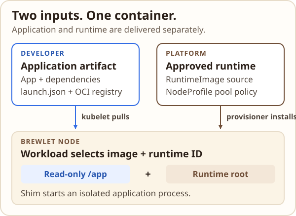
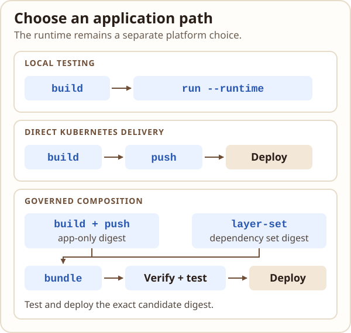
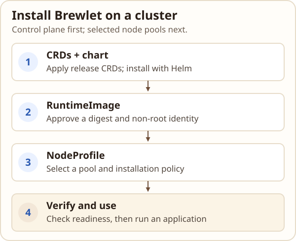
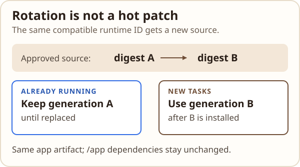

# Brewlet cheat sheet

Quick recipes for application developers and platform operators. Brewlet 0.x
is pre-GA beta software; evaluate it in an isolated environment. This page
does not replace the [full CLI reference](cli-reference.md) or deployment
guides. Select a diagram to open it at full size.

## The short version

[](assets/cheat-sheet/architecture.svg)

- **Application artifact** contains app and optional dependency layers under
  `/app`, plus explicit launch metadata. Brewlet does not detect languages,
  resolve dependencies, or guess an entrypoint.
- **RuntimeImage** is the platform-approved runtime source, pinned to an OCI
  digest. Its ID is the compatibility contract workloads request.
- **NodeProfile** controls which node pools offer runtimes and how the
  provisioner installs them.
- **Workload** remains a native Kubernetes Deployment, StatefulSet, DaemonSet,
  or other supported resource. It selects `runtimeClassName: brewlet` and an
  explicit runtime ID.

## Choose a workflow

[](assets/cheat-sheet/delivery-paths.svg)

| Workflow | Use it for | Main steps |
|---|---|---|
| Local development | Exercise an artifact with Docker or Podman before deploying. | `build` → `run` |
| Kubernetes deployment | Run an app using a runtime managed by the platform. | `build` → `push` or load artifact → apply workload |
| Direct packaging | Ship app and dependency layers together. | `build` → `push` |
| Governed composition | Independently approve dependency sets and compose at release time. | `layer-set` → app-only `build` → `bundle` → `verify` → test digest → deploy |
| Eager runtime install | Install approved runtime roots before node readiness. | Platform sets `install: Eager` (default) |
| OnDemand runtime install | Defer installing a root until a workload first requests it. | Platform sets `install: OnDemand`; first use has a bounded wait |

Eager and OnDemand are **runtime installation policies**, not different
application deployment formats. For a decision between Brewlet, conventional
application images, and Kubernetes image volumes, see
[When to use Brewlet](choosing-brewlet.md).

## Install Brewlet on a cluster

[](assets/cheat-sheet/cluster-install.svg)

Use an isolated cluster or explicitly controlled node pools. Target nodes need
Linux, systemd, cgroup v2, containerd 2.x with overlayfs, runc, and crictl.
You also need Helm, kubectl, registry access, and permission to install
cluster-scoped resources. Provisioning is privileged and modifies node and
containerd configuration. See the [installation guide](installation.md) for
the complete prerequisites.

These commands assume your current kube context already points at the target
cluster. They use the latest CLI and chart by default. If `BREWLET_VERSION` is
already set in your environment, unset it first; it overrides the CLI
installer's default. Confirm the CLI, CRDs, chart, and component images are
from the same release:

```sh
# Install Brewlet CLI
curl -fsSL https://brewlet.sh/install.sh | sh
export PATH="$HOME/.local/bin:$PATH"
brewlet version

# Install Brewlet CRDs
helm show crds oci://ghcr.io/microsoft/charts/brewlet \
  | kubectl apply -f -
helm upgrade --install brewlet \
  oci://ghcr.io/microsoft/charts/brewlet \
  --namespace brewlet --create-namespace --wait --timeout 5m
```

The chart installs the operator, admission webhook, and RuntimeClass, but
**does not provision any nodes by default**. First approve a runtime with the
Brewlet CLI. Preview the operation, then repeat without `--dry-run` to create
the `RuntimeImage`:

```sh
brewlet k8s runtime add python-3.13 \
  --image registry.example.com/golden/python:3.13 --dry-run

# After reviewing the resolved digest, image checks, and inferred UID/GID:
brewlet k8s runtime add python-3.13 \
  --image registry.example.com/golden/python:3.13
```

The CLI resolves the tag to a digest and infers UID/GID when the image declares
a numeric non-root user. If it cannot infer a suitable identity, add explicit
`--uid UID --gid GID` values. In this first-time flow, omit `--profile` because
the `NodeProfile` does not exist yet. Now save the following as
`node-profile.yaml`; replace its pool label and value with labels already on
the intended nodes:

```yaml
apiVersion: node.brewlet.sh/v1alpha1
kind: NodeProfile
metadata:
  name: application-pool
spec:
  nodePool:
    key: brewlet.example.com/pool
    names: [applications]
  runtimeImages:
    - id: python-3.13
      install: OnDemand
  rollout:
    containerdRestart: validated
    maxUnavailable: 1
  tolerations:
    - key: startup-taint.cluster-autoscaler.kubernetes.io/brewlet
      operator: Equal
      value: provisioning
      effect: NoSchedule
```

For GitOps, declare both resources in source control instead: `RuntimeImage`
manifests require a digest-pinned `spec.source.image` and explicit non-root
`spec.user.uid` and `spec.user.gid`. The values must match the runtime and
intended workload identity. Do not combine the GitOps-managed RuntimeImage
with the CLI creation command above. For example, save this as
`runtime-image.yaml` with the reviewed digest and numeric identity:

```yaml
apiVersion: node.brewlet.sh/v1alpha1
kind: RuntimeImage
metadata:
  name: python-3.13
spec:
  source:
    image: registry.example.com/golden/python@sha256:<64-lowercase-hex>
  user:
    uid: 65532
    gid: 65532
```

The pool label must select the intended nodes, and the approved runtime must
support their architectures and the selected non-root identity. Control-plane
nodes are excluded unless explicitly enabled. In the CLI flow, apply the
NodeProfile only. For GitOps, apply both manifests from source control. Then
check readiness:

```sh
kubectl apply -f node-profile.yaml
kubectl wait --for=condition=Ready \
  nodeprofile/application-pool --timeout=5m
kubectl -n brewlet get deployments,pods
kubectl get runtimeclass brewlet
kubectl get runtimeimages,nodeprofiles
kubectl get nodes \
  -L brewlet.sh/runtime -L brewlet.sh/runtime.python-3.13
brewlet k8s runtime status python-3.13
brewlet k8s doctor --namespace brewlet
```

For OnDemand, `available` can mean the validated baseline is ready but the
runtime root has not yet been fetched. Check that the startup fence is gone;
readiness alone does not prove an application can start. Deploy and test a
workload as shown below. For a complete disposable example, use the
[local Kubernetes tutorial](local-kubernetes.md); for removal, follow
[safe removal](uninstallation.md).

## Package and publish an application

Create a `launch.json` with the exact executable, arguments, working directory,
and environment your app needs. Then package explicit layers and platforms:

```sh
brewlet build registry.example.com/apps/api:v2 \
  --platform linux/amd64 \
  --launch launch.json \
  --layer dependency=./dependencies:/app/dependencies \
  --layer app=./src:/app/src

brewlet inspect registry.example.com/apps/api:v2
brewlet push registry.example.com/apps/api:v2 --push-result push.json
```

`build` writes a local OCI layout; it does not publish. `push` publishes the
existing layout without rebuilding or rewriting its bytes. Use `--store DIR`
with either command to choose a different layout. Add `.brewlet/` to
`.gitignore` when using the default build location.

For multi-platform artifacts, repeat `--platform`. The same supplied bytes are
asserted to work on each platform; platform-specific native payloads need
platform-scoped layers. See [multi-architecture images](multi-arch.md).

## Test locally

`brewlet run` runs a local build with an explicitly selected Docker or Podman
runtime image. It never guesses a runtime:

```sh
brewlet run registry.example.com/apps/api:v2 \
  --runtime python-3.13=registry.example.com/runtimes/python:3.13 \
  --publish 8080:8000 \
  --env APP_MODE=dev \
  --tmpfs /app/cache
```

`--runtime` accepts `IMAGE`, `ID=IMAGE`, or `ID` with `--from-cluster`.
For a cluster runtime, Brewlet reads it from the current kube context:

```sh
brewlet run registry.example.com/apps/api:v2 \
  --runtime python-3.13 --from-cluster \
  --dry-run
```

Arguments after `--` replace the descriptor's argument list. `--platform`
defaults to the host architecture; `--engine` defaults to
`$BREWLET_CONTAINER_ENGINE` or `docker`. Local execution does not reproduce
cluster admission, node authorization, runtime installation/rotation, or all
volume and identity behavior. See [local testing details](cli-reference.md#local-testing-with-brewlet-run).

## Deploy to Kubernetes

First, a platform operator approves a digest-pinned RuntimeImage and offers it
through a NodeProfile. Then deploy an ordinary workload with an explicit
runtime ID and image digest:

```yaml
apiVersion: apps/v1
kind: Deployment
metadata:
  name: api
spec:
  replicas: 1
  selector:
    matchLabels:
      app: api
  template:
    metadata:
      labels:
        app: api
      annotations:
        brewlet.sh/runtime-image: python-3.13
    spec:
      runtimeClassName: brewlet
      nodeSelector:
        kubernetes.io/arch: amd64
      containers:
        - name: api
          image: registry.example.com/apps/api@sha256:<digest>
          resources:
            requests:
              cpu: 100m
              memory: 64Mi
            limits:
              memory: 256Mi
          securityContext:
            readOnlyRootFilesystem: true
```

Replace the example image with the actual published digest and choose a runtime
ID and architecture approved by your platform. Apply and observe the native
resource with Kubernetes tools, replacing `apps` with an existing application
namespace:

```sh
kubectl --namespace apps apply -f deployment.yaml
kubectl --namespace apps rollout status deployment/api
kubectl --namespace apps describe pod -l app=api
```

See the [application packaging guide](applications.md) and
[first local Kubernetes deployment](local-kubernetes.md) for complete,
environment-specific instructions.

## Operate cluster runtimes

These are Brewlet CLI commands. They use the current kube context by default;
`--kubeconfig` and `--context` can select a different configuration.

[](assets/cheat-sheet/runtime-rotation.svg)

```sh
# Inspect approved runtimes and their current state
brewlet k8s runtime list
brewlet k8s runtime status python-3.13
brewlet k8s doctor --namespace brewlet

# Preview a runtime addition as manifests; review before applying
brewlet k8s runtime add node-22 \
  --image registry.example.com/runtimes/node:22 \
  --profile application-pool --install OnDemand --dry-run

# Rotate to a new source, or remove after checking impact
brewlet k8s runtime rotate python-3.13 \
  --image registry.example.com/runtimes/python:3.13.1 --dry-run
brewlet k8s runtime remove python-3.13 --dry-run

# Compare the approved generation with last-observed older task bindings
brewlet k8s runtime status python-3.13 -o json \
  | jq '{generation, digest, taskObservations: .status.taskObservations}'
```

`status` is a snapshot, not a complete history: it reports the approved
generation and observed older or previous-epoch bindings. Check each
observation's `current` and `observedAt` fields; stale bindings can be retained
when a node stops reporting.

To look up past Pod/container bindings, enable `metrics.enabled: true` and
scrape Brewlet's node metrics into a time-series system with sufficient
retention. Run this PromQL query at the desired time, replacing the Pod name:

```promql
brewlet_container_runtime_image_info{namespace="apps", pod="api-<pod-suffix>"}
```

The metric labels include the Pod and container identities, runtime ID,
inventory UID, generation, and digest. Samples can miss short-lived containers
or collection gaps. Source-controlled `RuntimeImage` changes record intended
configuration, not which generation each container actually used. See
[look up historical runtime bindings](observability.md#look-up-historical-runtime-bindings)
for range queries, ownership joins and retention limits.

`add` resolves a tag to a digest. Prefer digest-pinned inputs in reviewed
configuration. Mutations support `--dry-run`; `rotate` and impactful forced
removal require `--yes` when applied. The examples preview changes only; review
the impact before applying a mutation. Rotation changes the generation used by
new tasks; it does not hot-patch running processes. Follow the
[rotation and cleanup guide](operations.md) for rollout, revocation, and safe
removal behavior.

## Govern dependency releases

Use a layer set when the platform and application teams publish dependencies
and application bytes separately. The release pipeline composes immutable
digests and verifies the exact candidate before deployment:

```sh
brewlet layer-set registry.example.com/platform/python-deps:2026.11 \
  --config layerset.json --lock dependencies.lock.json \
  --layer dependency=./dependencies:/app/dependencies

brewlet build registry.example.com/builds/api:payload \
  --platform linux/amd64 --launch launch.json \
  --layer app=./src:/app

brewlet bundle registry.example.com/releases/api:candidate \
  --application registry.example.com/builds/api@sha256:<app-digest> \
  --layer-set registry.example.com/platform/python-deps@sha256:<set-digest> \
  --platform linux/amd64 --policy release-policy.yaml

brewlet verify registry.example.com/releases/api@sha256:<candidate-digest> \
  --platform linux/amd64 --policy release-policy.yaml
```

Test the verified candidate digest, then deploy that exact digest. Production
composition also needs authorized signing configuration. For policy, trust,
and inventory details, see
[governed dependency composition](managed-composition.md).

To export observed workload/dependency facts for an external scanner, replace
`/path/to/kubeconfig` with a single file containing the current context and its
cluster and user configuration. Unlike the commands above, `inventory`
requires an explicit kubeconfig and context:

```sh
brewlet inventory \
  --kubeconfig /path/to/kubeconfig \
  --context "$(kubectl config current-context)" \
  --namespace payments --policy inventory-policy.yaml \
  --output inventory.json
```

Inventory observes and exports facts; it does not scan CVEs or mutate
workloads. Incomplete evidence returns a partial report and a nonzero exit.

## Quick reminders

- Runtime IDs, platforms, launch metadata, and registry references are explicit;
  Brewlet does not infer them.
- All application containers in one Brewlet Pod use the same runtime ID and
  version-1 artifact contract.
- `/app` is read-only and world-readable. Never put secrets there; use scoped
  Secret volumes and explicit writable mounts for data.
- Rotating a runtime does not update dependency copies packaged under `/app`.
- `--insecure` explicitly selects HTTP; it does not disable TLS verification.
- Pin workload and governed-release images by digest. Keep producer credentials
  out of artifacts and use origin-scoped registry credentials.
- Confirm the current kube context before cluster operations. Review
  `--dry-run` output before applying changes.
- Brewlet 0.x is pre-GA beta software. Use an isolated evaluation cluster and
  follow [safe removal and recovery](uninstallation.md).

## More help

```sh
brewlet version
brewlet --help
brewlet <command> --help
```

See the [complete CLI reference](cli-reference.md) for all commands and flags,
including advanced `index` usage, registry configuration, and output formats.
