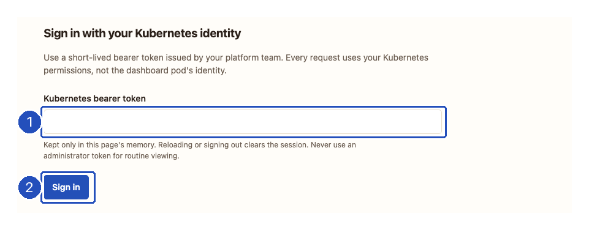
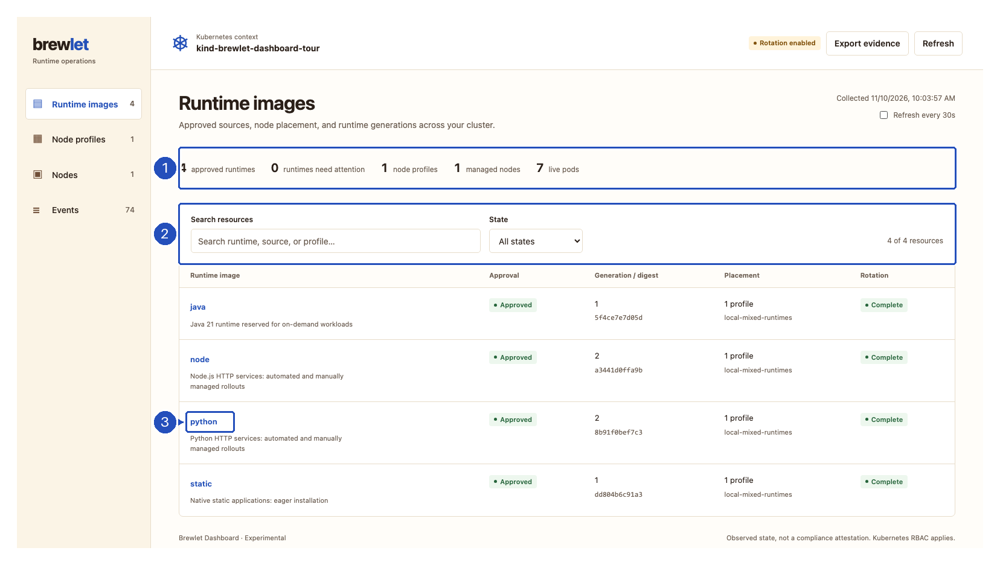
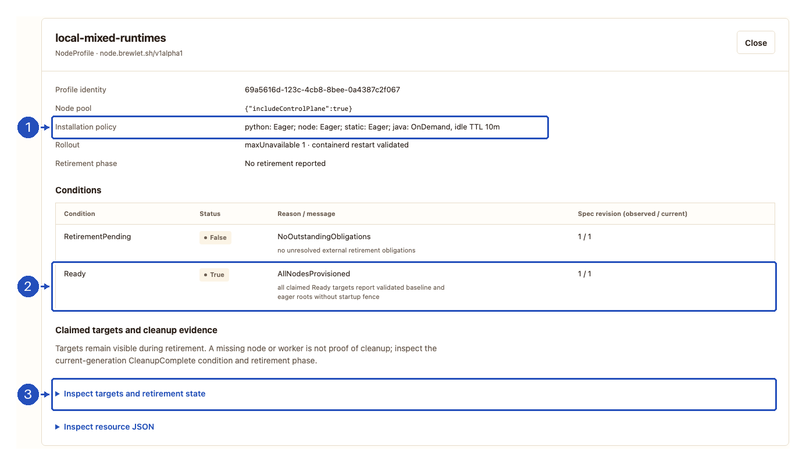
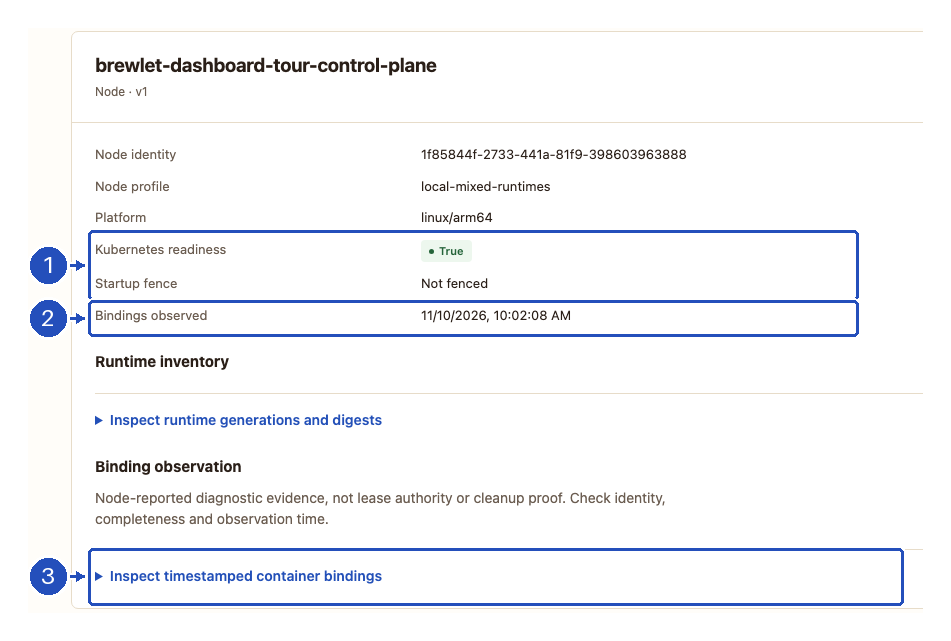
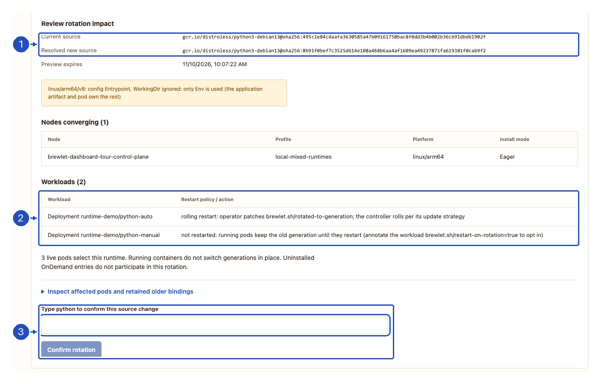
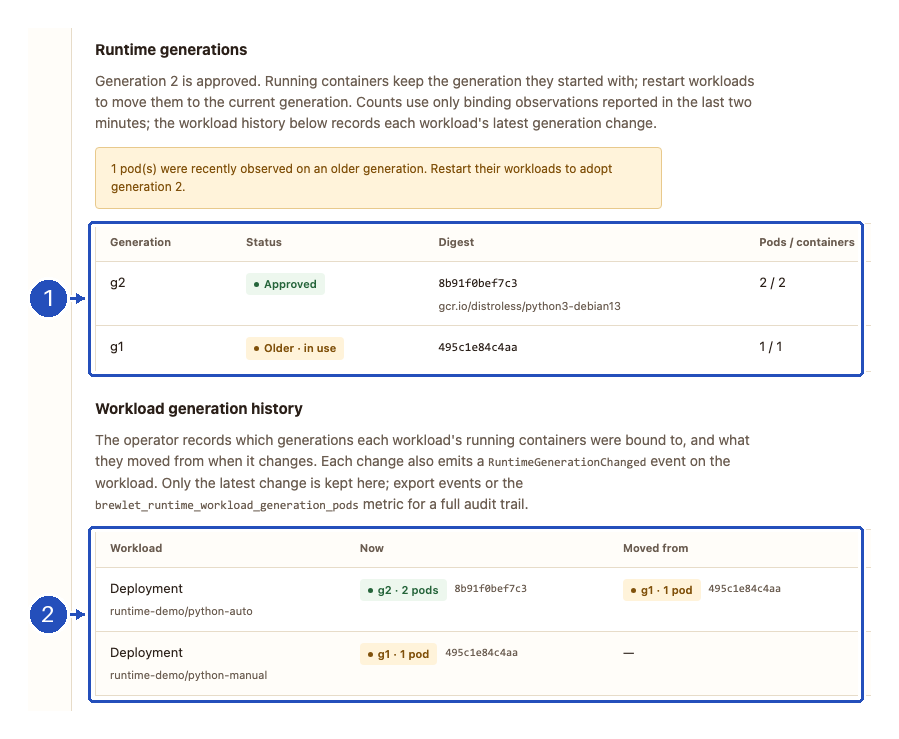
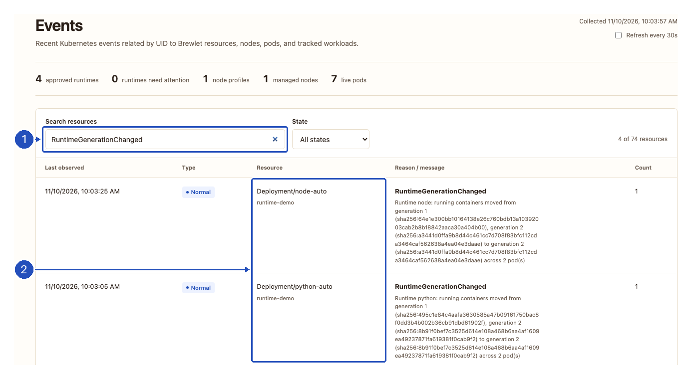

# Brewlet Dashboard

The experimental Brewlet Dashboard gives Kubernetes operators a centralized view
of runtime infrastructure using Brewlet's native `RuntimeImage` and
`NodeProfile` APIs. It does not deploy application workloads or replace the
Kubernetes API server.

Install the dashboard on the cluster with the optional Helm component, or run
the embedded dashboard locally with your kubeconfig. Both serve the same
dependency-free frontend; no external CDN or JavaScript build is required.
Like the rest of Brewlet, it is pre-GA: evaluate it in a disposable environment.

| Connection | Identity used for Kubernetes requests | Best fit |
| --- | --- | --- |
| [Installed dashboard](#install-on-the-cluster) | Each operator's short-lived Kubernetes bearer token | A shared dashboard behind your platform's HTTPS proxy, or loopback port-forward access. |
| [Local session](#run-a-local-session) | Your selected kubeconfig identity | Private workstation access, including private-registry image preflight. Never expose this mode through a shared proxy or tunnel. |

Once connected, follow the [operator walkthrough](#operator-workflows) to inspect
placement, rotate a source and verify which workloads adopted it. Creating
runtimes and profiles, deploying applications and removing resources remain
CLI or GitOps operations.

## Install on the cluster

The dashboard ships in the published chart (Brewlet 0.9.0 and later), which
contains the matching CRDs and a digest-pinned dashboard image, so no separate
image build or override is needed. The commands below install the latest
release into the cluster selected by your current kubectl context; review the
prerequisites in [installation](installation.md) first. Use them for a fresh
installation, not to upgrade an older release. Helm does not upgrade CRDs, so
apply them before installing the chart:

```sh
helm show crds oci://ghcr.io/microsoft/charts/brewlet | kubectl apply -f -
helm upgrade --install brewlet \
  oci://ghcr.io/microsoft/charts/brewlet \
  --namespace brewlet --create-namespace \
  --set dashboard.enabled=true \
  --wait --timeout 5m
```

To enable the dashboard on an existing installation, use the same chart
version. For an installation already on the latest release, preserve its
configured values:

```sh
helm upgrade brewlet \
  oci://ghcr.io/microsoft/charts/brewlet \
  --namespace brewlet \
  --reset-then-reuse-values \
  --set dashboard.enabled=true \
  --wait --timeout 5m
```

For an older release that includes the dashboard, add
`--version <installed-chart-version>` to the upgrade command instead.
Find the installed chart version with `helm list -n brewlet`; in-place upgrades
between releases are unsupported.

The chart installs the dashboard as a ClusterIP service, disabled by default.
For private-registry mirroring, set `dashboard.image` to your mirrored,
digest-pinned image. Keep the image from the same Brewlet release as the chart.

To open it from your workstation, port-forward the service:

```sh
kubectl -n brewlet port-forward service/brewlet-dashboard 8088:8088
```

Open **http://127.0.0.1:8088**. This deployment is a hardened, single-replica
Deployment with an unprivileged ServiceAccount. Readiness/liveness probes report
process availability, not cluster health or the signed-in operator's
permissions. Disabling the dashboard on a later Helm upgrade removes only the
dashboard component.

### Sign-in and Kubernetes RBAC

Sign in using a short-lived Kubernetes bearer token issued by your platform.
The server sends that token only to its trusted in-cluster Kubernetes API
endpoint. It does **not** act as the pod ServiceAccount, impersonate users, or
grant the dashboard pod inventory/write roles. Kubernetes audit logs therefore
identify the caller's token identity.

The chart creates `brewlet-dashboard-viewer` (for release name `brewlet`),
intentionally without bindings. It grants read access to RuntimeImages,
NodeProfiles, Nodes, Pods, Events and workload controllers across namespaces.
Review that scope before granting it to a platform group or dedicated reader
identity. If the platform's Kubernetes authentication issues bearer tokens for
users in a group, an administrator can bind that group:

```sh
kubectl create clusterrolebinding brewlet-dashboard-viewers \
  --clusterrole=brewlet-dashboard-viewer \
  --group=platform-operators
```

Alternatively, an administrator can create a dedicated reader ServiceAccount
and issue a short-lived token for it:

```sh
kubectl -n brewlet create serviceaccount runtime-reader
kubectl create clusterrolebinding runtime-reader-view \
  --clusterrole=brewlet-dashboard-viewer \
  --serviceaccount=brewlet:runtime-reader
kubectl -n brewlet create token runtime-reader --duration=15m
```

Obtain each operator's token through your platform's approved identity process.
Use distinct identities when actor attribution matters. A shared ServiceAccount
token attributes actions to that ServiceAccount, not to the human using it.
There is no built-in OIDC login or token refresh flow. Do not bind the roles to
the dashboard's own ServiceAccount. These bindings and any reader
ServiceAccounts are administrator-managed; Helm does not remove them.

Tokens stay in page memory, never URL parameters or browser storage. Reloading
requires signing in again; **Sign out** clears the token, inventory, evidence
and previews, including in-flight results. Signing out does not revoke the
Kubernetes token or undo an already-submitted operation. Rejected/expired
credentials return to sign-in.

[](assets/dashboard/sign-in.png)

**1.** Paste your short-lived token into the empty field. **2.** Choose
**Sign in** to load inventory with that token's permissions. The screenshot
contains no credential. Use **Sign out** in the header when finished; an
expired or rejected token returns you to this form.

### Shared HTTPS access and runtime rotation

For shared access, configure your TLS-terminating ingress or proxy to route the
HTTPS origin to `brewlet-dashboard:8088`, and set the chart value
`dashboard.publicURL` to that exact origin, such as
`https://runtimes.example.com`. For example, add
`--set dashboard.publicURL=https://runtimes.example.com` to the install or
upgrade command above. The chart does not create an Ingress, certificate or
public LoadBalancer. Preserve the Host header, serve at the origin root, and
restrict in-cluster access to the trusted proxy with your platform's network
policies. Proxy identity headers are not trusted as Kubernetes credentials.
Never log Authorization headers or request tokens at the proxy. The browser
refuses token entry over non-loopback HTTP; loopback port-forward access remains
available even when a public origin is configured.

To enable confirmed runtime rotations, add
`--set dashboard.allowWrite=true` to the Helm install or upgrade command. This
creates the `brewlet-dashboard-operator` role, which grants `patch` on
RuntimeImages only. Bind it to the appropriate operator group or identity, in
addition to viewer access:

```sh
kubectl create clusterrolebinding brewlet-dashboard-operators \
  --clusterrole=brewlet-dashboard-operator \
  --group=platform-sre
```

No bindings are created automatically. Previews are bound to the caller's token
and expire after five minutes; a pod restart or credential change invalidates
them.

The **Rotation enabled** badge reports the dashboard server's configuration,
not the signed-in caller's permission to patch a runtime. A viewer can see that
badge without having the operator role. It also does not mean that workloads
are opted in to automatic restarts; those are
[separate settings](#choose-workload-restart-behavior).

In-cluster image preflight currently supports registries readable without
credentials. Shared `BREWLET_REGISTRY_USERNAME/PASSWORD` are rejected in cluster
mode: arbitrary preview references must not receive shared registry secrets.
For private-registry preflight, use a local dashboard with your own registry
credentials. Browsing existing private-runtime evidence does not require
registry access.

## Run a local session

Install Brewlet on the cluster first; see [installation](installation.md).
Use your normal kubeconfig and explicitly select the intended context:

```sh
brewlet k8s --context my-cluster dashboard
# Or select a kubeconfig file:
brewlet k8s dashboard --kubeconfig ./cluster.config --context my-cluster --port 8088
```

Open the **complete private URL** printed by the CLI in your browser. The server
listens only on `127.0.0.1`; `--port 0` selects an available port. It does not
open a browser automatically. Stop the process with Ctrl+C.

Read-only is the default, even if your Kubernetes identity can write. To enable
the runtime source rotation workflow:

```sh
brewlet k8s --context my-cluster dashboard --allow-write --namespace brewlet
```

`--namespace` identifies the operator Deployment for restart-policy inspection,
not an inventory filter. RuntimeImages and NodeProfiles are cluster-scoped;
the dashboard reads related pods and events across namespaces. To switch
clusters or identities, stop the server and start a new session.

## Operator workflows

| View | What it shows |
| --- | --- |
| Runtime images | Approval, approved generation and digest, desired versus approved source, offering profiles, rotation and restart state. |
| Runtime details | Runtime generations in use (approved generation plus older generations with freshly observed container bindings, pod and node counts), separately labeled stale evidence, last rotation time, conditions, per-node convergence (Current / Behind), the runtime generation each selecting pod runs, per-workload generation history (current and previous generations, change time), raw binding evidence, and resource JSON. |
| Node profiles | Eager/OnDemand placement and idle TTLs, ready/assigned counts, current-generation readiness, targets, retirement and cleanup conditions. |
| Nodes | Readiness, platform, startup fence, per-runtime installation and digest, timestamped container-binding observations and explicit stale/invalid/missing evidence warnings. |
| Events | The newest 200 retained Kubernetes events whose referenced UID matches the observed Brewlet resources, nodes, pods or workloads tracked in runtime generation/restart status; older related events are counted as omitted. |

The screenshots show a real Brewlet 0.9.0 deployment on one disposable
Linux/arm64 kind node, captured on November 10, 2026. Python, Node.js and
native/static roots were installed; Java was approved and offered OnDemand,
but left uninstalled. These are cropped captures with numbered outlines and
arrows, not synthetic resource state or a multi-node qualification. Select an
image to open it at full resolution. The dashboard expects resources to exist
already; see [runtime and profile setup](runtime-images.md) and
[packaging and deploying applications](applications.md).

### Read the resource ledger

[](assets/dashboard/runtime-inventory.png)

**1.** The summary remains cluster-wide when you switch views or filter the
list. Four approved runtimes do not imply that four roots are installed on
every node. **2.** Search and **State** narrow the current resource list.
**3.** Select a runtime name to open its details below the list; use **Close**
to return to the ledger.

Search works across each view's resource data; runtime search also matches
offering profile names. For example, search for `python` to find that runtime,
or `local-mixed-runtimes` to find all runtimes offered by the example profile.
**No matching resources** means the current search or filter matched nothing,
not that the cluster has no resources.

Refresh manually or every 30 seconds. Automatic refresh pauses while the page
is hidden, while a rotation is being reviewed, or while focus is inside the
resource details. If a resource group cannot be read, it is marked unavailable,
not treated as an empty successful result. If the connection fails, the last
snapshot is explicitly stale and rotation is disabled.

On narrow screens, navigation moves above the inventory. Resource tables can
scroll horizontally; scroll within the table to reach columns outside the
viewport.

### What the state filter means

The **Healthy** and **Needs attention** filters use different checks for each
view. They are operational shortcuts, not an assessment of application health,
security or complete workload adoption.

| View | Healthy means |
| --- | --- |
| Runtime images | Approved, desired source matches approved source, `RotationComplete=True` observes the current spec revision, and no failed restart tasks are reported. |
| Node profiles | Not deleting, with `Ready=True` observing the current spec revision. |
| Nodes | Kubernetes Ready, not startup-fenced, with valid inventory and no binding-observation warning. |
| Events | A non-`Warning` event. **Needs attention** selects `Warning` events, not unhealthy resources. |

**A healthy runtime can still have pods on an older generation.** Pending,
rolling or deferred restart tasks do not by themselves make the runtime match
**Needs attention** either. In the screenshot above, the summary reports zero
runtimes needing attention, even though manual workloads still use generation
1. To find those workloads, inspect
[Runtime generations and Workload generation history](#verify-rotation-and-workload-adoption).

### Inspect placement and node evidence

Choose **Node profiles**, then select a profile name:

[](assets/dashboard/node-profile.png)

**1.** Read the installation policy before interpreting node coverage.
`Eager` installs an offered root ahead of workloads; `OnDemand` installs it
when needed and can remove it after its idle TTL. In this example, an
uninstalled Java root is intentional, not failed provisioning.
**2.** Check readiness against the current spec revision.
**3.** Expand **Inspect targets and retirement state** for claimed node
identities and cleanup evidence. Readiness is not a cleanup receipt.

Next, choose **Nodes** and select a node:

[](assets/dashboard/node-evidence.png)

**1.** Kubernetes readiness and the startup fence describe scheduling state,
not whether every workload has adopted the newest runtime.
**2.** Check the binding observation's timestamp; missing, stale or
identity-mismatched evidence means container bindings are unknown.
**3.** Expand **Inspect timestamped container bindings** to inspect the
observation. **Inspect runtime generations and digests** separately shows
the node's reported inventory. See
[evidence freshness and limits](#evidence-is-not-an-audit-log) before drawing
conclusions from either.

### Choose workload restart behavior

Rotating a source and replacing application pods are separate decisions.
The dashboard cannot configure workload opt-in or change rollout strategies.

| Gate | What it enables |
| --- | --- |
| `dashboard.allowWrite=true` or local `--allow-write`, plus caller patch RBAC | Preview and confirm a runtime source change through the dashboard. |
| `operator.rotationRestarts.enabled=true` in the Helm release | Allow the operator to restart eligible, opted-in workloads after rotation. This is disabled by default. |
| `brewlet.sh/restart-on-rotation: "true"` on the workload controller | The workload owner's consent to those restarts. Put it on Deployment/StatefulSet/DaemonSet metadata, **not** on the Pod template. |

To enable automatic restarts, add
`--set operator.rotationRestarts.enabled=true` to the appropriate same-release
Helm install or configuration-update command, then merge this annotation into
each existing workload that should opt in:

```yaml
metadata:
  annotations:
    brewlet.sh/restart-on-rotation: "true"
```

Leave that annotation absent or `"false"` to retain manual control.
The operator uses the workload's existing update strategy; `OnDelete` still
requires manual replacement, and paused or partitioned rollouts can defer
adoption. Review [restart policy, namespace restrictions and admission
safeguards](operations.md#rotate-without-rebuilding-application-bytes) before
enabling this in a shared cluster.

### Rotate a runtime

1. Enable `dashboard.allowWrite` for an installation (or `--allow-write` locally),
   select a runtime and choose **Rotate source**.
2. Enter a registry image tag or digest and choose **Preview rotation**.
3. Review the resolved digest, platform/config checks, compatibility warnings,
   affected nodes, selecting workloads and their restart actions, and live pods.
4. Type the exact runtime ID and choose **Confirm rotation**.

[](assets/dashboard/rotation-preview.png)

**1.** Verify the current source, resolved new digest and any warnings.
**2.** Read each workload's restart action: `python-auto` will roll;
`python-manual` will not restart. Also check the participating nodes and
expand **Inspect affected pods and retained older bindings** if needed.
**3.** Type `python` for this example to enable confirmation; use your selected
runtime's exact ID, not its image reference or digest.

Preview performs the same registry resolution and golden-image config checks
used by the CLI. The new source is always digest-pinned; insecure registry
transport and skipped image checks are not exposed in the dashboard. Local-mode
registry authentication uses the CLI's [registry environment](cli-reference.md#registry-access);
cluster mode has the registry limitation described above.

Confirmation uses a server-signed preview that expires after five minutes,
re-reads the runtime and impact, and patches only `spec.source.image` with an
optimistic resource-version lock. A changed runtime (including a status update),
changed reported impact, expired preview, or mismatched confirmation requires a
new preview. Other resources can still change after the impact read; the preview
is not a cluster-wide transaction or reservation.

A successful request is **not proof that rotation completed**. Refresh and
inspect the operator's conditions, node generations and restart summary.
Existing containers retain their leased generation. Rolling restarts require
both operator configuration and workload opt-in; OnDemand roots not yet
installed are excluded from the participating nodes.

Approval creation, placement edits and runtime removal remain
[CLI](cli-reference.md#cluster-runtime-management-with-brewlet-k8s) or GitOps
operations. For a Helm-managed runtime, update chart values as well, or a later
Helm upgrade may revert the source.

### Verify rotation and workload adoption

After confirming, choose **Refresh** and reopen the runtime if necessary:

1. In **Conditions**, verify that `RotationComplete=True` observes the current
   spec revision. Check the rotation participants and any excluded nodes.
2. In **Node installation**, check that participating installed roots are
   **Current**, rather than **Behind** or unknown.
3. In **Runtime generations**, look for **Older · in use** as well as the
   approved generation. Then use **Workload generation history** and
   **Pods selecting this runtime** to identify workloads that have not moved.

[](assets/dashboard/runtime-generations.png)

**1.** The node has converged to generation 2, but fresh observations still
bind one pod to generation 1. **2.** `python-auto` replaced its two pods and
adopted generation 2; `python-manual` retained its original pod on generation
1. The application image did not change. The same split was observed for
the Node.js workloads.

The runtime's **Restart summary** describes the operator's tracked restart
tasks, not all selecting workloads:

| Summary field | How to interpret it |
| --- | --- |
| `pending` | Restart work is queued or awaiting processing. |
| `rolling` | A rollout is in progress; wait for controller availability and runtime-binding evidence. |
| `complete` | The operator's restart completion checks passed for those tracked tasks. Manual workloads can still retain older generations. |
| `deferred` | Work cannot yet finish; inspect the workload's strategy, progress and node/binding evidence. |
| `failed` | A restart failed or exceeded its progress deadline; inspect conditions, workload rollout and events before retrying. |

The compact summary does not show every possible per-workload outcome.
For example, `OnDelete` is reported as `NotApplicable` in
`status.restarts.workloads`, not counted as a completed rolling restart.
Expand **Inspect resource JSON** for per-workload reasons when the summary is
insufficient.

To move a manual Deployment, use your normal deployment process or explicitly
restart it. For the example workload, substituting your context and namespace:

```sh
kubectl --context my-cluster -n runtime-demo rollout restart deployment/python-manual
kubectl --context my-cluster -n runtime-demo rollout status deployment/python-manual
```

Refresh again and check fresh binding evidence rather than assuming that a
successful rollout command alone proves runtime adoption. If you deliberately
leave manual workloads running, their older-generation warning is expected.

## Access boundary and permissions

Local mode uses your selected kubeconfig identity, including normal client-go
credential plugins. Installed mode uses each signed-in caller's bearer token.
Kubernetes RBAC is the authority for every operation; the dashboard never
elevates access.

| Workflow | Required Kubernetes access |
| --- | --- |
| Inventory and evidence | `list` RuntimeImages and NodeProfiles in `node.brewlet.sh`; `list` core Nodes, Pods and Events. Pods and Events are read across namespaces. |
| Rotation preview and confirmation | Inventory access above; `get` RuntimeImages and Nodes; `list` Deployments, StatefulSets and DaemonSets across namespaces; `get` the `brewlet-operator` Deployment in `--namespace`. |
| Apply rotation | `patch` the selected RuntimeImage, in addition to preview permissions. Admission policy still applies. |

If operator configuration is unreadable, workload restart actions explicitly
say that restart settings are unknown; this is not interpreted as permission to
restart. Other missing preview dependencies fail the preview.

In local mode, the URL fragment contains a random per-process bearer token. The frontend
removes it from the address bar, holds it only in page memory, and sends it in
an authorization header for API calls. **After reloading, reopen the original
printed URL.** Keep that URL private; anyone holding it on the machine can use
the dashboard with the process's Kubernetes identity and enabled write scope.

Local kubeconfig credentials never go to the browser. Evidence responses are not cached;
the server rejects unexpected Host headers and cross-origin API requests,
does not enable CORS, and serves a restrictive content security policy.
The preview signing key is separate from the browser's access token.

Do not expose **local mode** through an ingress, reverse proxy, shared
port-forward or tunnel: anyone with its private URL inherits the process's
Kubernetes identity. Loopback does not isolate other local processes.
Use `--in-cluster` via the Helm deployment for multi-user access instead.

## Evidence is not an audit log

**Export evidence** downloads the last collected, timestamped JSON snapshot,
including partial-read errors, omitted-event counts and a stale flag. Kubeconfig,
session tokens, arbitrary node annotations, Pod specifications and workload
environment variables are not included. Resource names, registry references,
event messages and runtime bindings can still be sensitive; handle exported
files accordingly.

The snapshot consists of sequential API reads, not an atomic cluster view.
Kubernetes events expire and aggregate repeated occurrences; they do not prove
who changed a resource or preserve every change. For durable actor-attributed
change history, configure Kubernetes API audit logging and retention outside
the dashboard.

The operator emits `RuntimeApproved` when it first approves a runtime, then
`RotationStarted` for a new digest and `RotationComplete` when participating nodes
have converged. These events identify the runtime generation and digest;
`RotationStarted` also includes the previous generation and digest.
Completion reports participating and excluded node counts, not a workload
restart receipt: existing containers may still use older generations.
Events are emitted after the corresponding status is persisted, regardless of
whether the change came from the dashboard, CLI or GitOps. Rotations completed
before an operator with this event support was installed are not backfilled.

Node annotations report current-generation bindings. RuntimeImage
`status.taskObservations` retains older or foreign-epoch task/lease tuples,
including stale observations. The dashboard exposes completeness, identity and
timestamps rather than inferring that missing observations mean zero bindings.
A recent observation is diagnostic evidence, not cleanup authority.
The **Runtime generations** table counts only fresh evidence: node binding
observations that are complete, identity-matched and no more than two minutes
old, plus `taskObservations` entries the operator still marks `current` within
the same window. Each container is counted once. Bindings from older or
non-current observations appear separately under **Stale evidence** with their
last-observed time; they may have exited and are not counted as in use. Nodes
without a fresh observation are named, because their containers are unknown.
The table shows which generations workloads use now, not a durable history: a
retired generation disappears once no fresh observation binds a container to
it. Brewlet's
runtime generation (`g2`) is `status.generation`, which increments on each
approved source change; it is distinct from the Kubernetes spec revision
(`metadata.generation`) shown with conditions.

### Auditing when a workload changed generation

Rotation never restarts running containers by itself; a workload adopts a new
runtime generation only when its pods are replaced, whether by a manual
`kubectl rollout restart`, a deploy, node churn or opted-in rotation restarts.
The operator therefore records the change from binding evidence, not from the
restart that caused it:

- RuntimeImage `status.workloadGenerations` lists each owning workload
  (ReplicaSet pods are attributed to their Deployment; uncontrolled pods are
  their own workload) with the generations, digests and pod counts its running
  containers are bound to, the previous set and `changedAt`. Only the latest
  change is kept. A workload with no running pods keeps its last observed
  generations with zero pods; a deleted workload is removed.
- Each change emits a `RuntimeGenerationChanged` event on the workload, for
  example `Runtime python: running containers moved from generation 2
  (sha256:…) to generation 3 (sha256:…) across 2 pod(s)`. A rolling update
  typically emits two: old → old + new, then old + new → new.
- `brewlet_runtime_workload_generation_pods` reports pods per workload and
  generation, so Prometheus retains the full timeline.

To inspect these changes, choose **Events** and search for
`RuntimeGenerationChanged`. Search for `RotationStarted` or `RotationComplete`
instead to inspect source rotation and node convergence:

[](assets/dashboard/workload-events.png)

**1.** Search matches the event reason, resource and message.
**2.** These events belong to the tracked **Deployments**, not just the
RuntimeImages. A `RotationComplete` event says that participating nodes
converged; a `RuntimeGenerationChanged` event records observed workload
adoption. Neither identifies the human actor. Use **Export evidence** in the
header to save the last collected snapshot, including retained events and
any collection errors.

Records change only when every node claimed for the runtime has a fresh,
complete binding observation, so missing evidence never looks like a change.
The first observation of a workload is recorded without an event, and changes
are not backfilled. The operator reads only metadata of pods, ReplicaSets,
Deployments, StatefulSets, DaemonSets and Jobs for this (`get`, cluster-wide); a
workload kind it cannot read is retained rather than presumed deleted. The runtime details panel shows this as **Workload
generation history**, and the Events page includes the workload events. Events
expire, so export them or keep the metric for a durable audit trail; neither
identifies who restarted the workload — use Kubernetes API audit logs for that.
NodeProfile cleanup still requires current-generation `CleanupComplete`
conditions and the retirement lifecycle; a missing node or worker proves
neither cleanup nor safe deletion.

## Troubleshooting

| What you see | What to check or do |
| --- | --- |
| Sign-in returns to the token form | Obtain a current short-lived token through your platform's identity process. Rejected/expired credentials require signing in again; missing permissions are a separate RBAC issue. |
| **Read-only**, or no **Rotate source** button | Local mode needs `--allow-write`; installed mode needs `dashboard.allowWrite=true`. Stale or incomplete inventory also disables rotation. Caller patch RBAC is still required even when the button or **Rotation enabled** badge is visible. |
| A resource group is **unavailable** | Inspect the reported API error and the [required Kubernetes access](#access-boundary-and-permissions). Restore access and refresh. An unreadable group is unknown, not empty. |
| **Cluster data unavailable** or a stale snapshot | Restore the cluster/browser connection, check credentials and refresh. For a reloaded local page, reopen the original private URL printed by the CLI. Do not rely on the old snapshot to authorize a rotation. |
| **No matching resources** | Clear search and choose **All states**. A healthy-filter result does not prove that no old-generation pods remain. |
| Image preflight fails | Correct the image reference and check registry access, platform support and the returned validation message, then preview again. Installed mode cannot use shared private-registry credentials; use local mode for private preflight. |
| Preview expired or runtime/impact changed | Cancel, refresh and create a new preview. Preview tickets expire after five minutes; even a runtime status update can invalidate one. |
| Confirmation fails or its connection is lost | Do not assume either success or failure. Cancel and refresh the runtime to check the desired source before preparing another preview. |
| Rotation is complete but older pods remain | Check workload opt-in, operator restart configuration and rollout strategy, then inspect fresh bindings. Manual workloads retain their leased generation until replaced. |
| Restart work is deferred or failed | Inspect `status.restarts.workloads`, controller rollout, node readiness and binding freshness. Review [rotation operations](operations.md#rotate-without-rebuilding-application-bytes) for strategy and deadline behavior. |

For registry, provisioning and cleanup failures outside the dashboard, use
the [cluster troubleshooting guide](troubleshooting.md).
