# Guided demonstration: the Java canvas

**One app. One runtime ID. No image rebuild.** The
[`brewlet-demo` canvas extension](https://github.com/microsoft/brewlet/tree/main/.github/extensions/brewlet-demo)
runs this demonstration inside the GitHub Copilot app. It builds
[ShowMyJVM](https://github.com/brunoborges/showmyjvm), a Spring Boot application,
packages it without a JDK, and deploys it on a private kind cluster. The Java
runtime comes from the node's approved infrastructure, not the application image.

You then rotate the existing `temurin-25` RuntimeImage from Temurin
**25.0.4.1+1 to 25.0.5+8**, and back. The canvas records the live JVM, Pod,
application digest, runtime binding and bundled CA roots after each rollout.
Both builds are Java 25: the point is a runtime patch and trust-store change,
not a switch between major Java versions.

This is a contributor and presenter tool, not the Brewlet runtime dashboard.
The screenshots below show the real extension; this documentation page does
not run it. For a smaller, terminal-only introduction without Java or the
Copilot app, use [First local deployment](local-kubernetes.md).

## Open the canvas

Clone the repository if you do not already have it:

```sh
git clone https://github.com/microsoft/brewlet.git
```

Open that repository in the **GitHub Copilot app** and start a local session.
The extension is included at `.github/extensions/brewlet-demo/`. Once the
repository's extensions have loaded, ask Copilot:

> Open the Brewlet live demo canvas.

The panel opens with guided stages above a **Live terminal**. Scroll the guide
independently of the terminal. Each **Run stage** button executes real commands;
**Show commands & inputs** lets you inspect them first.

[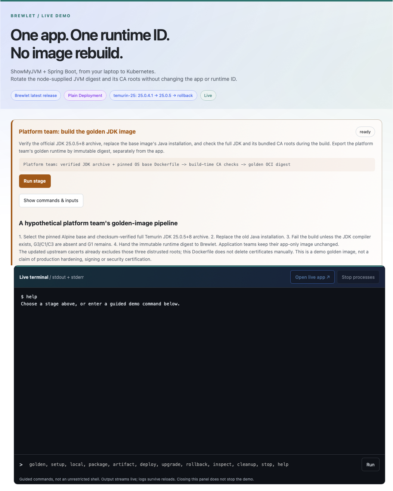{ width=1052 height=1312 }](assets/demo/canvas-overview.png)

*The canvas is the control surface for the demonstration, not a slide or a
simulated terminal. Select any screenshot in this guide to open it at full size.*

The command box accepts guided names such as `preflight`, `golden`, `setup`,
`local`, `package`, `artifact`, `deploy`, `upgrade`, `rollback`, `inspect`,
`cleanup` and `stop`. It is **not an unrestricted shell**. Run one stage at a
time and wait for its **passed** badge before continuing.

## Prepare the demonstration

### Check prerequisites and choose Brewlet

You need Docker running a Linux engine with Buildx, **kind v0.33.0**, kubectl,
Helm, Git, Maven and a local **JDK 25**. Docker must use an amd64 or arm64
architecture. Network access is needed for the application source, Maven
dependencies, release downloads and public runtime images.

In **Before the spotlight**, keep **Latest release** selected and choose
**Check prerequisites**. The canvas resolves the latest Brewlet release and
uses that same version for the Helm chart and checksum-verified packaging CLI.
The version shown in the panel is the one this session will use.

[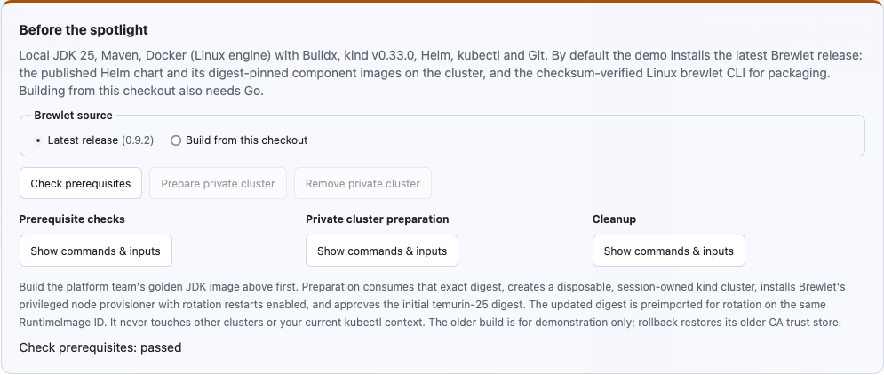{ width=995 height=422 loading=lazy }](assets/demo/prerequisites.png)

*Release selection and prerequisite checks happen before cluster creation.*

**Build from this checkout** is an alternative for contributors. It also
requires Go and builds Brewlet from the checkout's committed `HEAD`, not its
uncommitted edits. Remove the demo cluster before switching sources.

To select a particular local JDK, set `BREWLET_DEMO_JAVA_HOME` in the environment
used to start the Copilot session. `BREWLET_DEMO_VERSION=X.Y.Z` similarly selects
a Brewlet release instead of resolving the latest one.

The screenshots were captured with Brewlet 0.9.2 on Linux/arm64 through Docker
on November 14, 2026. Your release version, paths, Pod names and digests may
differ. The demo deliberately pins its comparison JDK builds, archive
checksums and kind node image so that the trust-store comparison is repeatable.

### Build the platform team's golden JDK

Return to **Platform team: build the golden JDK image** and choose **Run stage**
(`golden`). This is a separate platform task, before application packaging.

The stage downloads and checksum-verifies the official full Temurin 25.0.5+8
musl JDK archive. Its Dockerfile retains the pinned Alpine base, replaces
`/opt/java/openjdk` with that archive, and runs a build-time verifier:

[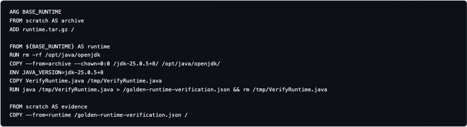{ width=954 height=260 loading=lazy }](assets/demo/golden-dockerfile.png)

*The Dockerfile and verification source are visible in the canvas. The
application is not an input to this build.*

The build fails unless the exact vendor/build and JDK compiler are present,
**emSign ECC Root CA - G3**, **emSign Root CA - C1** and
**emSign ECC Root CA - C3** are absent from bundled `cacerts`, and
**emSign Root CA - G1** remains present. The updated archive already has these
root-store contents; the Dockerfile does not manually delete certificates.

[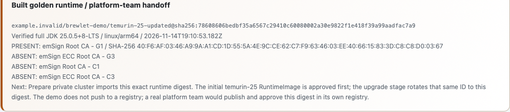{ width=995 height=220 loading=lazy }](assets/demo/golden-verification.png)

*The platform handoff is an immutable runtime digest with measured build
evidence, not a new application image.*

This is a **private demo golden image**, not an official Temurin container or
a claim of production hardening. A real platform pipeline would additionally
qualify, publish, sign and approve its runtime image. This stage does not upload
anything to a registry.

### Prepare the private cluster

Choose **Prepare private cluster** (`setup`) and confirm the operation. The
canvas creates a session-owned kind cluster with a private kubeconfig, installs
Brewlet with rotation restarts enabled, and approves the initial Temurin
25.0.4.1+1 source as **`temurin-25`**. A NodeProfile offers that ID on the node.

Preparation also imports the golden runtime's exact digest for the later
rotation. It does **not** rebuild it or create a second RuntimeImage ID.
Wait for preparation to pass before deploying the application.

[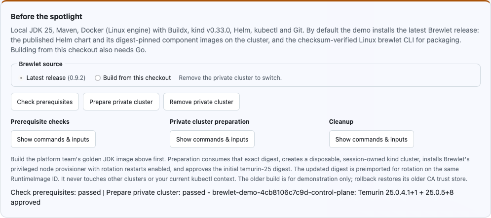{ width=995 height=442 loading=lazy }](assets/demo/cluster-ready.png)

*Both runtime sources are available for the demonstration; the initial source
is active under the single `temurin-25` ID.*

!!! warning "Local, privileged demonstration"
    Setup installs Brewlet's privileged node provisioner in the disposable
    cluster. The extension uses its own kubeconfig and does not change your
    current kubectl context. It refuses to adopt an unrelated cluster with
    the same name. Do not repurpose this flow for a production cluster.

## 1. Build and run locally

Choose **Run stage** on **1. Build & run locally** (`local`). The extension
fetches ShowMyJVM's current default-branch commit, records that revision, and
builds its Spring Boot module with Maven and your local JDK 25.

It starts the JAR on a loopback port and records the JVM returned by
`/jvm/inspect.json`. **Open local app** in the evidence area opens this laptop
process. Its patch version can differ from the two deliberately selected
cluster runtimes.

## 2. Package the app-only image

Run **2. Package app-only OCI image** (`package`). The extension extracts the
Spring Boot application and dependency JARs, then uses a Linux producer to run
`brewlet build`.

The resulting OCI artifact contains application files, including its library
JARs, in app layers and a `launch.json` layer. **It contains no JDK.** The
producer's build environment does not become part of the application artifact.

[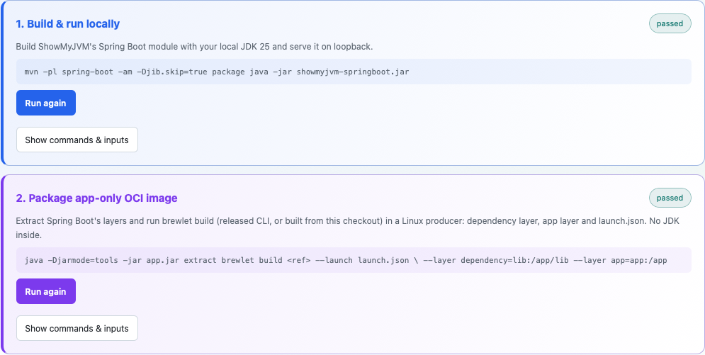{ width=995 height=501 loading=lazy }](assets/demo/app-packaging.png)

*Build and package once. Keep this application image through deployment,
runtime rotation and rollback.*

## 3. Explore the OCI artifact

Run **3. Inspect the OCI artifact** (`artifact`). This read-only step verifies
manifest, config and layer hashes, indexes archive entries, and fails if a
layer contains `bin/java` or `libjvm.so`.

In the **OCI / Artifact Explorer**, select the application and launch layer
cards. The right-hand pane shows the actual paths in the selected layer; its
filter searches those paths.

[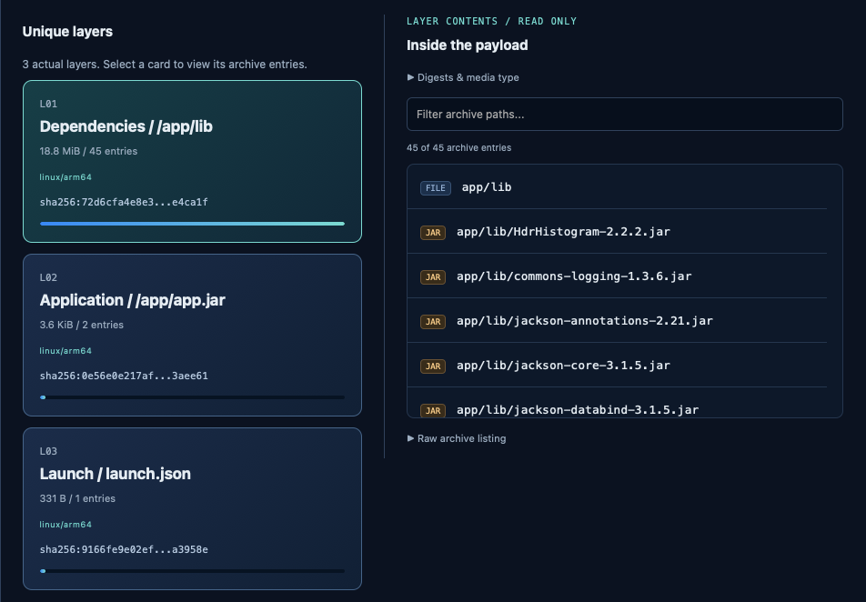{ width=952 height=662 loading=lazy }](assets/demo/artifact-layers.png)

*Layer cards describe the application's actual payload, not the producer image
used to build it.*

Select **launch.json** under **Launch contract & configuration** to inspect
the launch contract. It tells Brewlet how the application starts using the
node-supplied Java installation. **OCI image configuration** is a separate
metadata view, not another filesystem layer.

[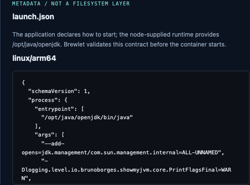{ width=506 height=374 loading=lazy }](assets/demo/launch-contract.png)

*The launch contract travels with the app; the executable it selects comes
from the approved runtime.*

## 4. Deploy on the initial runtime

Choose **Show Deployment YAML** to inspect the resolved manifest before
running **4. Deploy on Temurin 25.0.4.1+1** (`deploy`).
**Source template** shows the repository template; **Deployment YAML** shows
the resolved input, including the application digest.

[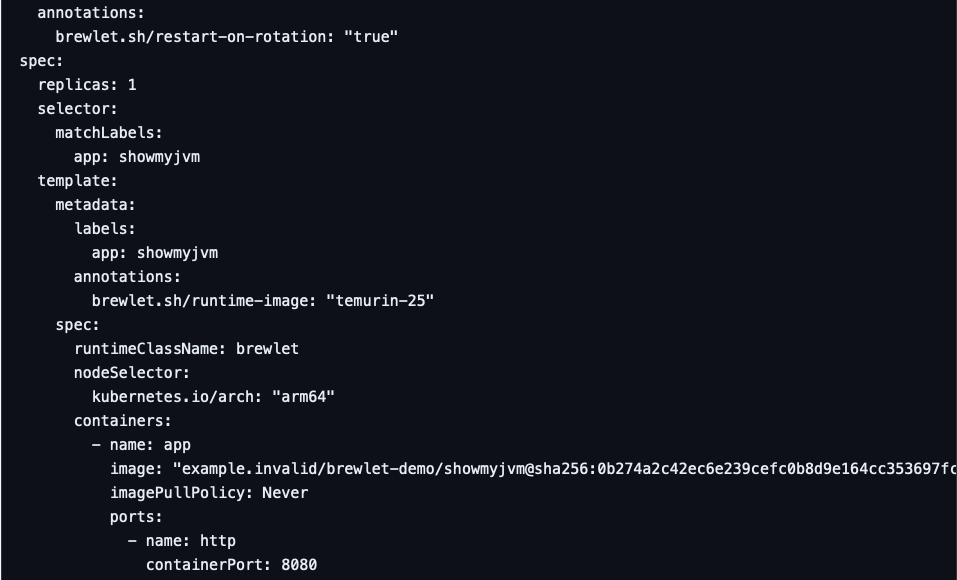{ width=957 height=580 loading=lazy }](assets/demo/deployment.png)

*This is a plain Kubernetes Deployment. The runtime selector belongs to the
Pod template; the restart-on-rotation opt-in belongs to the Deployment.*

The important fields are `runtimeClassName: brewlet`,
`runtime-image.brewlet.sh/app: temurin-25`, and
`brewlet.sh/restart-on-rotation: "true"`. Deployment imports the app artifact
directly into the private node's containerd; it does not push it to a registry.

After the stage passes, choose **Open live app**. This opens the
Service-backed ShowMyJVM dashboard with automatic refresh. It is a different
process from **Open local app**: the JVM now runs in Kubernetes.

[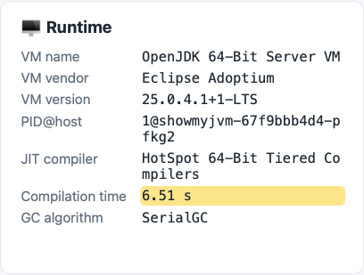{ width=408 height=309 loading=lazy }](assets/demo/initial-jvm.png)

*The initial live JVM is measured through the Service, not inferred from the
RuntimeImage's name.*

The canvas also verifies the ready Pod's Deployment ownership, its container
imageID against the packaged OCI artifact, the node's runtime binding and all
four emSign roots in the JVM's bundled `cacerts`.

## 5. Rotate the runtime without rebuilding the app

Run **5. Rotate temurin-25 to Temurin 25.0.5+8** (`upgrade`).
The extension changes **`spec.source.image` on the existing RuntimeImage** to
the golden digest. It does not package another app or change the Deployment's
`temurin-25` selector.

Brewlet first converges the node to the new runtime generation. Its
rotation-restart controller then rolls the opted-in Deployment. Existing JVM
processes are not patched in place: a replacement Pod starts the same app
artifact using the new node runtime.

[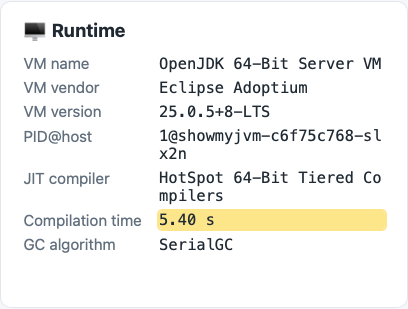{ width=408 height=309 loading=lazy }](assets/demo/updated-jvm.png)

*The JVM build changes while the application digest and runtime ID stay the
same. The live page can briefly reconnect during rollout.*

Wait for **passed**, then inspect the comparison at the bottom of the canvas.
G3, C1 and C3 should now be absent from bundled `cacerts`; G1 should still be
present. These are live measurements, not conclusions drawn from the version
string alone.

## 6. Roll back and compare the evidence

Run **6. Rotate temurin-25 back to Temurin 25.0.4.1+1** (`rollback`).
This restores the original source digest on the same RuntimeImage, creating
another runtime generation and another normal workload rollout.

!!! warning "Rollback restores the old trust store too"
    The older runtime exists here only to demonstrate the change. Restoring
    it also restores the three removed CA roots; this is not a security
    recommendation for production.

In **Same artifact, same runtime ID**, compare all three captured rollouts:

[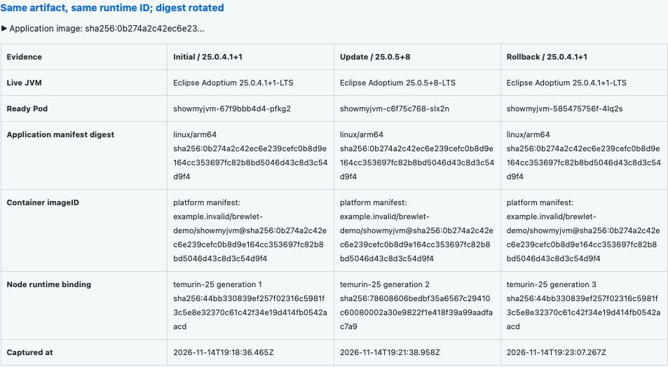{ width=953 height=524 loading=lazy }](assets/demo/runtime-comparison.png)

*Read across the application manifest and container imageID rows: the app is
unchanged. Read across the runtime-binding row: the ID stays `temurin-25`,
while its digest changes and its generation advances.*

The bundled-root table makes the runtime change visible independently of the
JVM version:

[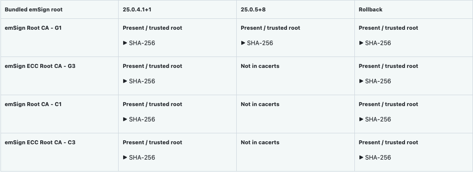{ width=953 height=347 loading=lazy }](assets/demo/trust-store-comparison.png)

*Expand **SHA-256** to see captured fingerprints for roots that are present.
The evidence comes from `${java.home}/lib/security/cacerts`, not the OS
certificate store.*

**Inspect deployment** (`inspect`) refreshes current workload, runtime and
NodeProfile information and rechecks the live binding. It is distinct from
the historical evidence captured after each rollout. If you stopped the
Service proxy, **Reconnect app** uses this inspection to restore access.

## Stop and clean up

Choose **Remove private cluster** (`cleanup`) in **Before the spotlight** and
confirm. The extension removes the workload namespace, waits for NodeProfile
host cleanup, removes the RuntimeImage and Helm release, then deletes its
owned kind cluster.

Use **Stop processes** (`stop`) to stop the local Java process as well.
Stopping processes alone does **not** delete the cluster or its Deployment.
Closing the canvas alone does not stop the demonstration.

Application artifacts, the golden-runtime build, captured state and terminal
logs remain under `brewlet-demo/` in the session workspace. That lets you
review the evidence after removing the cluster.

## What this demonstrates

The Java runtime can be managed as **node infrastructure**, independently of
an application-only image. One runtime ID can move between approved source
digests, with opted-in workload replacement and evidence tying the live JVM
back to the unchanged application artifact.

This local demonstration does not prove registry authentication, image
signing, production hardening, fleet-wide compatibility or performance.
The root-store comparison is not a TLS exploit test, does not claim that all
emSign roots were removed, and does not establish a fix for a specific CVE.
For a broader evaluation, see [verification and limitations](verification.md).
